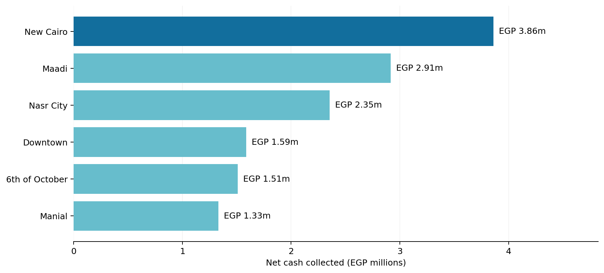
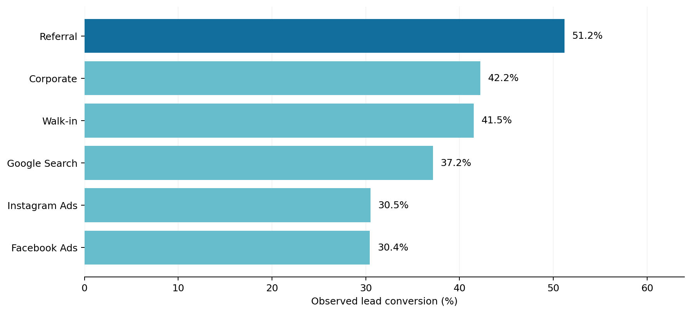

# Super Fit Gym Analytics

**Merna Mamdooh | Data Analytics Portfolio**

An analysis of membership, cash collection and customer acquisition for a fictional gym network. The project connects operational data to branch-level decisions and demonstrates data modeling, KPI design, validation and visualization.

**Period:** 1 October 2025 to 30 September 2026  
**Currency:** EGP  
**Data:** Fully synthetic, with fictional branch locations and test-only contact details.

[Read the six-page case study](reports/Super_Fit_Case_Study.pdf) · [View the analysis code](src/analyze.py) · [Explore the dataset](data/Super_Fit_Gym_Synthetic_Dataset.xlsx)

## Business questions

- Which branches contribute the most cash collected?
- How much contract value remains unpaid, and how much is already overdue?
- Which acquisition channels lead in conversion rate and converted volume?
- How can member, contract, payment and visit data be combined without double counting?

## Project scope

The wider Super Fit project includes a gym management dashboard, branch exploration, map views, operational data updates and user roles. This repository presents its analytical case study and a reproducible Python analysis of the supplied workbook. The figures below are generated analytical exhibits. They are not screenshots of the application.

My project work covers requirements, data structure, metric definitions, dashboard design and the operational reporting workflow. This repository makes the analytical logic and supporting results available for review.

## Dataset

| Table | Records | Grain |
| --- | ---: | --- |
| Branches | 6 | One branch |
| Plans | 6 | One membership plan |
| Employees | 72 | One employee |
| Members | 1,200 | One unique member |
| Leads | 3,400 | One prospect |
| Memberships | 1,641 | One contract |
| Payment_Schedule | 2,741 | One scheduled installment |
| Payments | 2,573 | One collection or refund |
| Attendance | 38,774 | One gym visit |
| Sales_Targets | 144 | One salesperson-month target |

The workbook also includes usage notes and a field dictionary. A searchable [CSV data dictionary](data/data_dictionary.csv) is included.

### Relationship design

- `Member_ID` links members to contracts and visits. One member can hold multiple contracts.
- `Membership_ID` links contracts to payments, installments and attendance.
- `Branch_ID` identifies the selling branch. `Visit_Branch_ID` identifies the branch actually visited.
- Payment transactions must be aggregated to contract level before combining their totals with contracts. Joining raw payments and visits together can multiply rows and overstate totals.

## KPI definitions and results

All results use the complete workbook period. Status fields are evaluated at **30 September 2026**, rather than the date the script runs.

| KPI | Definition | Result |
| --- | --- | ---: |
| Contract value | Sum of contract value after discounts, before credits | EGP 14,673,425 |
| Adjusted contract value | Contract value less credits | EGP 14,317,625 |
| Collections | Positive collection transactions | EGP 13,910,540 |
| Refunds | Signed refund transactions | EGP -355,800 |
| Net cash collected | Collections plus signed refunds | EGP 13,554,740 |
| Outstanding | Adjusted value less net cash | EGP 762,885 |
| Overdue | Unpaid amount already due at the snapshot | EGP 247,216 |
| Cash to adjusted value | Net cash / adjusted contract value | 94.7% |
| Lead conversion | Converted leads / all leads | 35.3% |

**Important distinctions:** Adjusted contract value is a sales measure, not recognized accounting revenue. Outstanding includes future installments; overdue is only its already-due portion. Refunds are already negative and must not be subtracted a second time.

## Findings

### 1. Two branches account for half of net cash



New Cairo leads with **EGP 3,859,435** in net cash. New Cairo and Maadi together account for approximately **50.0%** of the total.

Maadi has **EGP 65,460** overdue, close to New Cairo's **EGP 65,963**, despite a smaller adjusted contract base. Overdue relative to adjusted value is **2.10%** in Maadi versus **1.62%** in New Cairo.

**Recommended next step:** Review Maadi's installment aging and follow-up process, then compare contract mix and payment schedules before attributing the difference to collection performance.

### 2. Channel efficiency and volume tell different stories



- Referrals have the highest observed conversion rate: **51.2%**, or **174 of 340** leads.
- Facebook Ads generate the most converted leads: **344**, from **1,130** leads, at **30.4%** conversion.

**Recommended next step:** Test a referral initiative while monitoring both conversion volume and rate. Review paid-channel lead quality and follow-up using the same reporting definitions.

Marketing spend is unavailable, so these results cannot establish channel ROI or cost per acquisition. Open leads remain in the denominator. Lead age and incomplete follow-up may affect the snapshot comparison.

## Data quality and reconciliation

The analysis runs **28 checks** before generating the reports:

- Blank and duplicate primary keys in nine entity tables.
- Unmatched foreign keys across seven selected core relationships.
- Membership-level cash reconciled against aggregated signed payment transactions.
- Adjusted value reconciled to cash plus outstanding for each contract.
- Overdue balances between zero and outstanding for each contract.

Additional payment-type and sign guards reject unexpected transaction types, negative collections or positive refunds. All checks pass for the supplied workbook. These are targeted controls, not a claim that every possible business rule has been audited.

[View check results](reports/validation_checks.csv)

## Reproduce the analysis

Use Python 3.10 or later. From the repository root:

```bash
python -m venv .venv
```

Activate the environment:

```bash
# Windows PowerShell
.venv\Scripts\Activate.ps1

# macOS / Linux
source .venv/bin/activate
```

Then run:

```bash
python -m pip install -r requirements.txt
python src/analyze.py
```

This regenerates:

- `reports/metrics.json`: headline values and reporting context.
- `reports/branch_summary.csv`: branch-level measures.
- `reports/acquisition_summary.csv`: channel counts and conversion rates.
- `reports/validation_checks.csv`: validation results.
- `images/branch_cash.png` and `images/channel_conversion.png`.
- `data/data_dictionary.csv`.

The PDF is a static presentation of this dataset and is not regenerated by the script. If the data changes, revise the narrative, reporting dates and PDF as well as rerunning the calculations.

## Tools demonstrated

Python, pandas, Matplotlib, Excel data inspection, relational data modeling, KPI definitions, reconciliation, and business reporting. `openpyxl` supplies the Excel-reading engine. This repository does not claim to contain the web application's deployment source or a Power BI report.

## Limitations

This is an independent training project using synthetic data. Branch sizes, acquisition mix and contract duration can affect comparisons. Recommendations are hypotheses for operational follow-up. No real commercial improvement or causal marketing effect is claimed.
